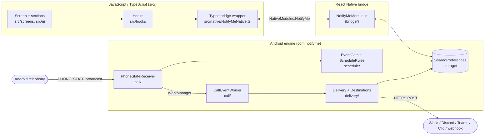

# 2. Architecture

**What you'll learn:** the three layers of the app, which one owns what, and the main design decision behind the split: everything that must work while the app is closed lives in Android code, not JavaScript.

## The big picture



There are two independent paths:

- **Settings path (app open):** the screen → hooks → bridge → `NotifyMeModule` → saved settings. This is ordinary app UI.
- **Alert path (app may be closed):** Android tells `PhoneStateReceiver` the phone is ringing → schedule check → background job → message posted → history row saved. **No JavaScript runs on this path.**

The two paths meet at **storage**. The UI writes settings that the engine reads, and the engine writes history that the UI reads.

## Why the engine is native (Java/Kotlin), not JavaScript

React Native runs your JavaScript only while the app is alive. When the user swipes the app away, or Android kills it to save memory, there is no JS runtime. Phone calls arrive at any time, so:

- **Detecting calls** has to be an Android `BroadcastReceiver`, declared in the manifest. Android starts the app process just to deliver the event.
- **Sending the webhook** has to survive the process being killed and must wait for the network. That's what Android's **WorkManager** is for.
- **Deciding** whether to alert (office hours, overrides) has to be readable by that native code. So the rules live natively, and the UI asks the native side "would a call be posted right now?" (`getStatus`) instead of re-implementing them.

The JS layer is therefore **UI only**. It never builds a webhook message or decides about a call. It edits settings and displays state.

## Who owns what

| Concern | Owner | Why there |
|---|---|---|
| Layout, forms, validation hints, toasts | JS (`src/`) | Fast to iterate on, and hot-reloads |
| Destination *setup screen* (labels, icons, extra fields) | JS (`src/destinations/`) | Only matters while the app is open |
| Destination *message format* (JSON body, URL, error text) | Android (`delivery/destinations/`) | Built when the app may be closed |
| "Is now inside office hours?" | Android (`schedule/ScheduleRules.java`) | Needed at ring time, without JS |
| Settings and history storage | Android (`storage/`) | Readable by both the engine and the bridge |
| Caller name and number lookup | Android (`call/`) | Uses Android system databases |

## The extension point: destinations

Adding a chat app touches exactly two places, one per side:

```
src/destinations/<name>.ts                                  ← how the setup form looks
android/.../delivery/destinations/<Name>Destination.java    ← what gets sent
```

Each side has a small registry (`src/destinations/index.ts` and `Destinations.java`) that lists them. They are matched by a string **id** (`"slack"`, `"cliq"`…), which is also what's saved on the phone. Walkthrough: [Add a destination](guides/add-a-destination.md).

## Layering rules inside `src/`

Imports only point "downward". This keeps each folder understandable on its own:

```
screens/   → may use hooks, destinations, domain, native, ui, theme
hooks/     → may use destinations, domain, native
destinations/ → may use domain, ui, theme
ui/        → may use domain (pure helpers), theme, and *types* from native — never calls native, hooks or screens
domain/    → pure functions, imports nothing from the app except types
native/    → the only place that touches NativeModules
theme/     → no app imports
```

Details: [Code conventions](CONTRIBUTING-CODE.md).

Next: [Project structure](03-project-structure.md)
