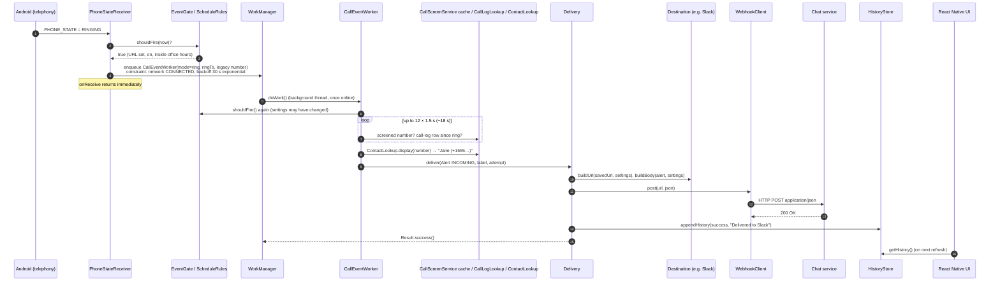
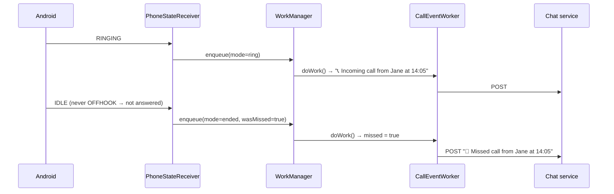
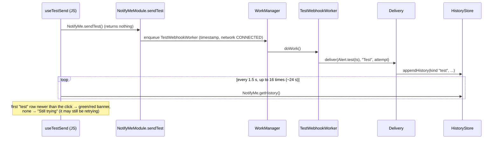

# 4. From a ringing phone to a chat message

**What you'll learn:** the exact path an incoming call takes through the app, class by class, until it shows up in Slack (or Discord, Teams, Zoho Cliq, a generic webhook) and in the Activity list. You'll also see how a missed call differs, how retries work, and how the "Send test" button reuses the same path. Keep this page open while reading the Android code. It is the map.

> Important: **none of this runs in JavaScript.** Calls must be noticed while the app is closed, when no JS is running at all. The whole flow is native Android code under [`android/app/src/main/java/com/notifyme/`](../android/app/src/main/java/com/notifyme/). The React Native UI only *configures* it and *reads the results* (history) afterwards.

---

## The short version

```
Phone rings
  └─ Android broadcasts PHONE_STATE ──► PhoneStateReceiver        (call/)
        └─ EventGate.shouldFire()? ──► ScheduleRules             (schedule/)
              └─ queue a job in WorkManager (wait for internet)
                    └─ CallEventWorker.doWork()                    (call/)
                          ├─ find the caller's number + name
                          └─ Delivery.deliver()                    (delivery/)
                                ├─ Destinations.current() → SlackDestination …
                                ├─ buildUrl() + buildBody()
                                ├─ WebhookClient.post()  ── HTTP POST ──► chat service
                                ├─ success / retry later / give up (DeliveryErrors)
                                └─ HistoryStore.appendHistory()    (storage/)
UI (later) ── NotifyMe.getHistory() over the bridge ──► Activity list
```

---

## Sequence diagram: an answered (or still ringing) incoming call



---

## Step by step

### 1. Android notices the call: `PhoneStateReceiver`

File: [`call/PhoneStateReceiver.java`](../android/app/src/main/java/com/notifyme/call/PhoneStateReceiver.java)

The manifest ([`AndroidManifest.xml`](../android/app/src/main/AndroidManifest.xml)) registers this class for the system broadcast `android.intent.action.PHONE_STATE`. Android calls `onReceive()` every time the phone's call state changes, **even when the app is closed**. It starts the app process just for this.

There are only three states: `IDLE` (nothing), `RINGING` (incoming call ringing) and `OFFHOOK` (a call is in progress). The receiver turns those into a tiny state machine:

| Transition | Meaning | What the receiver does |
|---|---|---|
| `IDLE → RINGING` | Incoming call | Remember `ringStart`, the legacy number (if any). Queue `CallEventWorker` with `mode = "ring"`. |
| `RINGING → OFFHOOK` | Call answered | Set `answered = true` (nothing is sent). |
| `RINGING → IDLE` (never `OFFHOOK`) | Missed or declined | Queue `CallEventWorker` with `mode = "ended"`, `wasMissed = true`. |
| `OFFHOOK → IDLE` after an answer | Normal hang-up | Nothing. |
| Same state twice | Duplicate broadcast | Ignored. |

Two things that look strange but are deliberate:

- **The state lives in `static volatile` fields.** Android creates a *new* receiver object for every broadcast and throws it away afterwards. Instance fields would forget that the phone was ringing by the time it goes idle. Static fields live as long as the app process does.
- **`onReceive` does almost nothing.** Android gives a receiver about 10 seconds and may kill the process right after. Slow work (reading the call log, HTTP) is handed to WorkManager.

Outgoing calls go `IDLE → OFFHOOK → IDLE` without ever `RINGING`, so they never trigger anything.

### 2. Should we alert at all? `EventGate` + `ScheduleRules`

Files: [`schedule/EventGate.java`](../android/app/src/main/java/com/notifyme/schedule/EventGate.java), [`schedule/ScheduleRules.java`](../android/app/src/main/java/com/notifyme/schedule/ScheduleRules.java)

Before queueing anything, the receiver asks `EventGate.shouldFire(context)`. `EventGate` loads the saved settings from `ConfigStore` and hands plain values to `ScheduleRules`, which decides. First match wins:

1. No webhook URL saved → **no** (checked in `EventGate`).
2. "Always on" override (`FORCE_ON`) not expired yet → **yes**, ignoring the master switch and office hours.
3. "Pause" override (`PAUSE`) not expired yet → **no**, even inside office hours.
4. Master switch off → **no**.
5. Otherwise → **yes only inside the weekly office-hours window.**

Overnight windows (e.g. 22:00–06:00) belong to the day they *start* on. So the early-morning part checks the *previous* day's bit. Expired overrides are cleared lazily by `EventGate` the next time it's asked; there is no timer.

The same check runs **three** times in different places: in the receiver (to avoid queueing useless jobs), in the worker (because the job may have waited for the network while settings changed), and in the bridge's `getStatus()` (to show "Watching for calls" in the UI).

### 3. Queue the work: WorkManager

The receiver builds a `OneTimeWorkRequest` for `CallEventWorker` with:

- **Input data:** `mode` (`ring` / `ended`), `ring_ts` (when it started ringing), `was_missed`, `number` (the legacy broadcast number, often empty).
- **Constraint: network `CONNECTED`.** WorkManager won't start the job until the phone is online. A late alert beats a lost one.
- **Backoff: exponential, starting at 30 s.** If the job asks to be retried, WorkManager waits 30 s, then 60 s, 120 s, …

WorkManager persists the queue to disk, so a queued alert survives the app being killed or even a reboot.

### 4. Who is calling? `CallEventWorker`

File: [`call/CallEventWorker.java`](../android/app/src/main/java/com/notifyme/call/CallEventWorker.java)

`doWork()` runs on a background thread, so it is allowed to sleep and poll. It:

1. Returns early (as "success", since this isn't an error) if the URL is now empty or `EventGate` now says no.
2. **Finds the number.** Since Android 10 the `PHONE_STATE` broadcast no longer contains it, so the worker tries several sources, polling up to **12 times × 1.5 s (~18 s)**:

   | Order | Source | When it works |
   |---|---|---|
   | a | **`CallScreenService` cache.** A number seen at ring time within ±15 s of `ring_ts`. | Only if the user granted the caller-ID ("call screening") role, Android 10+. Contacts also need `READ_CONTACTS`. |
   | b | **`CallLogLookup.latestSince(ringTs − 3 s)`.** The newest call-log row. | Needs `READ_CALL_LOG`. Some phones write the row at ring time, others only after the call ends. That's why it polls. |
   | c | **Legacy broadcast number** (`EXTRA_INCOMING_NUMBER`). | Android 9 and older, some OEMs. If present, the loop stops early and it's used as the fallback. |

3. **Answered or missed?** `missed = wasMissed || callLogRow.isMissed()` (the call-log type `MISSED` or `REJECTED`). In `ended` mode an answered call stops here: it was already alerted at ring.
4. **Builds the label** (`resolveLabel`): the call log's cached name (`"Jane (+1555…)"`) if the dialer stored one, otherwise `ContactLookup.display(number)`. That returns the contact name plus number, or just the number, or `""` when nothing is known. An empty label is shown as "number unavailable" in messages.
5. Creates an `Alert` (`INCOMING` or `MISSED`, the label, `ring_ts`) and calls `Delivery.deliver(...)`.

### 5. Send it: `Delivery`

File: [`delivery/Delivery.java`](../android/app/src/main/java/com/notifyme/delivery/Delivery.java)

```java
Destination destination = Destinations.current(ctx);        // from the saved platform id
DestinationSettings settings = DestinationSettings.load(ctx); // Cliq user/token
String body = destination.buildBody(alert, settings);        // JSON for that service
String url  = destination.buildUrl(savedUrl, settings);      // Cliq adds ?zapikey=
int code    = WebhookClient.post(url, body);                 // HTTP status
```

- [`Destinations.current()`](../android/app/src/main/java/com/notifyme/delivery/destinations/Destinations.java) maps the saved id (`"slack"`, `"discord"`, …) to a `Destination` object. Each service's JSON format lives in its own class. See [10. Destinations](10-destinations.md).
- [`WebhookClient.post()`](../android/app/src/main/java/com/notifyme/delivery/WebhookClient.java) is a plain `HttpURLConnection` POST with a 15-second connect and read timeout. It returns the HTTP status or throws for network problems.

### 6. Success, retry, or give up: `DeliveryErrors`

File: [`delivery/DeliveryErrors.java`](../android/app/src/main/java/com/notifyme/delivery/DeliveryErrors.java)

| Outcome | Example | What happens | History row? |
|---|---|---|---|
| HTTP 2xx | 200 | `Result.success()` | Yes: "Delivered to Slack" |
| **Permanent** HTTP error: any 4xx except 408 and 429 | 401 bad token, 404 deleted webhook | `Result.failure()` **right away**, since retrying would fail the same way | Yes, with a plain-language reason |
| **Permanent** exception | malformed URL, `http://` blocked ("Cleartext") | `Result.failure()` right away | Yes |
| Temporary error | 5xx, 408, 429, timeout, DNS, TLS | `Result.retry()`; WorkManager runs the job again after the backoff | **No**, not until the last attempt |
| Temporary error on the last attempt | | `Result.failure()` | Yes |

`Delivery.MAX_ATTEMPTS = 5`. The run-attempt count starts at 0 and it gives up once the count reaches 5, so a send runs **at most 6 times**. Because of the `CONNECTED` constraint, those attempts are only used while online.

Note that a retry re-runs the **whole** `doWork()`, including the caller lookup.

### 7. Record it: `HistoryStore`

File: [`storage/HistoryStore.java`](../android/app/src/main/java/com/notifyme/storage/HistoryStore.java)

`Delivery.recordSuccess` / `recordFailure` prepend one JSON row to the history (newest first, max 50):

```json
{"label": "Jane (+15550001111)", "kind": "incoming", "timestamp": 1700000000000,
 "success": true, "detail": "Delivered to Slack"}
```

### 8. The UI shows it

The UI never gets a push. It reads the history whenever it refreshes: on start, when the app comes back to the foreground, on pull-to-refresh, and after settings changes. It reads through the bridge (`NotifyMe.getHistory()` → [`NotifyMeModule.getHistory`](../android/app/src/main/java/com/notifyme/bridge/NotifyMeModule.kt) → `HistoryStore.getHistoryJson`). The Activity list then renders it (`src/ui/HistoryList.tsx`). See [7. The native bridge](07-native-bridge.md).

---

## Variant: a missed call

A missed call produces **two** messages: one when it starts ringing ("Incoming call") and one when it stops ringing unanswered ("Missed call"). Declining a call counts as missed too, because the phone goes `RINGING → IDLE` without `OFFHOOK`.



If the call was answered, the `ended` job is never even queued: the receiver only queues it when `ringing && !answered`. As a second safety net, the worker also returns early for `ended` when the call isn't missed. The `ended` job re-checks `EventGate`. So if office hours ended between the ring and the hang-up, the missed-call message is skipped.

---

## Variant: the "Send test" button

The test reuses steps 5–8 exactly, which is the point: if the test arrives, real alerts will too.



Files: [`bridge/NotifyMeModule.kt`](../android/app/src/main/java/com/notifyme/bridge/NotifyMeModule.kt) (`sendTest`), [`delivery/TestWebhookWorker.java`](../android/app/src/main/java/com/notifyme/delivery/TestWebhookWorker.java), and on the JS side [`src/hooks/useTestSend.ts`](../src/hooks/useTestSend.ts).

Why poll? `sendTest()` can't return the result. The job may run seconds later, wait for the network, or retry. The only shared place where the outcome appears is the history, so the UI watches it for a `"test"` row stamped after the click (with 1.5 s of slack for clock jitter).

---

Next: [5. React Native for web developers](05-react-native-for-web-devs.md)
