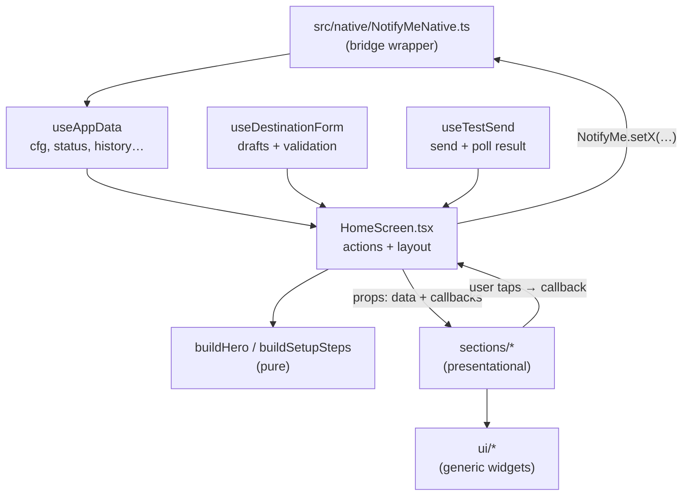

# 6. The UI layer

**What you'll learn:** how the TypeScript side is organized, how data flows from the phone to the screen and back, and the few patterns you'll see repeated in every file.

## Data flow in one picture



## HomeScreen: the controller

[`HomeScreen.tsx`](../src/screens/home/HomeScreen.tsx) is the only component that holds app state and calls the native module. Everything below it receives plain props.

It's laid out in four blocks:

1. **Data**: calls the hooks. All hooks run before any early `return` (React's rules of hooks).
2. **Early returns**: an error view if loading failed, a spinner until data arrives.
3. **Actions**: one function per user action (`saveDestination`, `onMaster`, `runTest`, `onToggleDay`…).
4. **Layout**: the scroll view with the sections in order.

Every settings change follows the same three steps:

```ts
NotifyMe.setDaysMask(mask);           // 1. write to the phone (fire-and-forget)
app.setCfg({...cfg, daysMask: mask}); // 2. update the screen right away (optimistic)
app.reread();                         // 3. read back the truth from the native side
```

Why step 3? The native side owns the rules. For example, it clears an expired override when asked, and `status.state` ("would a call be posted right now?") can only be computed there.

## Hooks

| Hook | Holds | Notes |
|---|---|---|
| [`useAppData`](../src/hooks/useAppData.ts) | config, status, caller-ID, battery, history | `refresh()` loads everything; `reread()` loads only what settings changes affect |
| [`useAppForeground`](../src/hooks/useAppForeground.ts) | — | runs a callback on mount and when the app returns to the front |
| [`useDestinationForm`](../src/hooks/useDestinationForm.ts) | URL/token/email drafts | `dirty`, `issues` (errors/warnings per field), `isValid`, `persist()` |
| [`useTestSend`](../src/hooks/useTestSend.ts) | the test result banner state | polls history because `sendTest()` returns nothing |

### Why "Send test" polls

`NotifyMe.sendTest()` only *queues* a job in Android's WorkManager, the same path a real call uses. That's intentional: the test then proves the real path works. The job runs moments later and writes a history row. So the hook checks history every 1.5 s (up to ~24 s) for a test row newer than the click.

A counter in a `useRef` (`runId`) acts as a **cancellation token**. Starting a new test or leaving the screen bumps it, and an older loop notices and stops. A ref is used instead of state because the running async loop must see the latest value, and changing it shouldn't re-render.

## Sections and pure builders

- **Sections** ([`sections/`](../src/screens/home/sections)) are one component per card. They render props and call callbacks. They don't call `NotifyMe` directly, except `ScheduleSection`, which opens the native time picker but still hands the result back through `onScheduleChange`.
- **Builders** ([`buildHero.ts`](../src/screens/home/buildHero.ts), [`buildSetupSteps.ts`](../src/screens/home/buildSetupSteps.ts)) are plain functions that turn data into "what to show". Keeping the decision rules outside JSX makes them readable and testable (`__tests__/buildHero.test.ts`).

## Destinations on the UI side

The destination card has no `if (platform === 'cliq')` checks. Instead it reads the selected [`DestinationDefinition`](../src/destinations/types.ts):

| Field | Used for |
|---|---|
| `label`, `icon`, `color` | the picker tile |
| `urlLabel`, `urlHelper`, `placeholder` | the URL field |
| `testDeliveredHint` | the "Test delivered" banner |
| `ExtraFields` (optional component) | extra inputs. Only Cliq has them (token, email) |
| `validate` (optional) | destination-specific warnings/errors on top of the shared https check |

## Theme

All colors come from [`palette.ts`](../src/theme/palette.ts), which has a `light` and a `dark` palette with identical keys. Components never hard-code a theme check; they use this pattern:

```tsx
const styles = (c: Palette) => StyleSheet.create({title: {color: c.text}});

function Title() {
  const [s, c] = useStyles(styles); // s = styles for the current scheme, c = palette
  return <Text style={s.title}>Hi</Text>;
}
```

`useStyles` memoizes the StyleSheet, so it's rebuilt only when the phone switches between light and dark mode. Keep the `styles` factory at module level (outside the component) so the memo works.

**Tone** ([`tone.ts`](../src/ui/tone.ts)) is a level above colors: components accept `tone="success" | "warning" | "danger" | "accent" | "neutral"` and map it to palette colors. That keeps the meaning ("this is a warning") separate from the exact color.

Spacing and corner radii come from the fixed scales in [`tokens.ts`](../src/theme/tokens.ts) (`SPACE.lg`, `RADIUS.md`…).

## UI kit (`src/ui`)

Generic widgets with no knowledge of calls or webhooks. Import them from `'../ui'`.

| Component | What it is |
|---|---|
| `Button` | primary / secondary / ghost, optional icon, loading spinner, compact size |
| `Field` | labeled text input with error > warning > helper message, optional secret mode |
| `Card`, `SectionHeader`, `SettingRow` | layout building blocks |
| `Pill`, `IconBadge`, `Banner` | status indicators |
| `StatusHero` | the big gradient status card with the master switch |
| `SetupChecklist` | progress bar and step list |
| `PlatformPicker`, `Segmented`, `DayChips`, `TimeTile` | choice controls |
| `HistoryList` | Activity rows or the empty state |
| `GradientFill` | SVG gradient background (React Native has no CSS gradients) |
| `useToast` | bottom snackbar, with optional Undo action |

Accessibility is built in: touch targets are at least 48dp, there are labels for screen readers, live regions for status changes, and "remove animations" is respected through `useReduceMotion`.

Next: [The native bridge](07-native-bridge.md)
