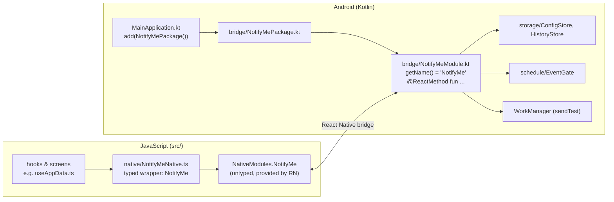

# 7. The native bridge (JavaScript ↔ Android)

**What you'll learn:** how the React Native UI talks to the Android engine. You'll see how a Kotlin method becomes a JavaScript function, which values can cross, why some calls return Promises and others don't, and how the typed TypeScript wrapper keeps the rest of the UI simple. At the end there's a reference table of every bridge method.

If you come from the web: think of the bridge as a tiny **local API**. The Kotlin module is the "server", `src/native/NotifyMeNative.ts` is the typed "API client", and `src/native/types.ts` holds the "response types". The difference is that there is no HTTP and no schema validation. The two sides just have to agree.

---

## The pieces



| File | Role |
|---|---|
| [`MainApplication.kt`](../android/app/src/main/java/com/notifyme/MainApplication.kt) | App startup. The one project-specific line is `add(NotifyMePackage())`. |
| [`bridge/NotifyMePackage.kt`](../android/app/src/main/java/com/notifyme/bridge/NotifyMePackage.kt) | Tells React Native "this app provides these native modules": a list with one entry, `NotifyMeModule`. A module that isn't listed in a package is invisible to JS. |
| [`bridge/NotifyMeModule.kt`](../android/app/src/main/java/com/notifyme/bridge/NotifyMeModule.kt) | The module itself. `getName()` returns `"NotifyMe"`, which is why JS sees `NativeModules.NotifyMe`. Every function marked `@ReactMethod` becomes a JS function with the same name. |
| [`src/native/NotifyMeNative.ts`](../src/native/NotifyMeNative.ts) | Typed wrapper. The **only** JS file that touches `NativeModules`. Exports `NotifyMe`. |
| [`src/native/types.ts`](../src/native/types.ts) | TypeScript shapes of what crosses the bridge (`Config`, `Status`, `HistoryEntry`, …) and the `OVERRIDE` strings. |
| [`src/native/index.ts`](../src/native/index.ts) | Re-exports both: `import {NotifyMe, Config} from '../native'`. |

---

## Two kinds of methods

### Promise methods (they return data)

If the **last parameter** of a `@ReactMethod` is a `Promise`, JS gets a function that returns a Promise:

```kotlin
// Kotlin: bridge/NotifyMeModule.kt
@ReactMethod
fun getBatteryStatus(promise: Promise) {
    val exempt = /* ask PowerManager */
    val map = Arguments.createMap().apply { putBoolean("exempt", exempt) }
    promise.resolve(map)          // call exactly once (or promise.reject(...))
}
```

```ts
// TypeScript
const battery = await NotifyMe.getBatteryStatus(); // { exempt: boolean }
```

### Fire-and-forget methods (they return nothing)

Without a `Promise` parameter, the JS call returns `undefined` immediately and the Kotlin code runs a moment later:

```kotlin
@ReactMethod
fun setMasterEnabled(enabled: Boolean) = ConfigStore.setMasterEnabled(reactContext, enabled)
```

All the `set…` methods work this way. That's why the UI follows "write, then read back":

```ts
NotifyMe.setDaysMask(mask);        // 1. write (fire-and-forget)
app.setCfg({...cfg, daysMask: mask}); // 2. update the screen immediately (optimistic)
app.reread();                      // 3. ask native for the truth (getConfig/getStatus/getHistory)
```

This works because calls to a module run one after another on the same background thread, so the `getConfig()` inside `reread()` runs after the write. SharedPreferences' `apply()` also updates its in-memory copy immediately, before saving to disk in the background.

---

## What can cross the bridge

Only simple values. There are no classes, functions or Dates.

| JavaScript | Kotlin parameter | Kotlin → JS (in a map) | Used for |
|---|---|---|---|
| `string` | `String` | `putString` | URL, platform id, override mode |
| `boolean` | `Boolean` | `putBoolean` | `masterEnabled`, `held`, `exempt` |
| `number` (small integer) | `Int` | `putInt` | minutes of day, days bitmask |
| `number` (epoch ms) | **`Double`** | **`putDouble`** | `overrideUntil`, `setOverride(untilMs)` |
| plain object | `ReadableMap` (in) | `WritableMap` via `Arguments.createMap()` (out) | `Config`, `Status`, `Screening`, `Battery` |
| array | `ReadableArray` | `Arguments.createArray()` | not used |

Two choices worth knowing:

- **Epoch milliseconds are `Double`, not `Long`.** JavaScript has one number type (a 64-bit double), and the bridge has no `Long`. Kotlin receives a `Double` and calls `.toLong()`. Today's timestamps fit in a double without losing precision.
- **History crosses as a JSON *string*.** `getHistory()` resolves with the raw string that's already stored on the phone, and the wrapper does `JSON.parse`. That avoids hand-converting a list of objects into a `WritableArray`. A corrupt value becomes `[]` instead of a crash.

---

## Threads

`@ReactMethod`s run on a React Native **background thread**, not the Android UI thread. That's fine for reading SharedPreferences. But anything that touches a View must hop to the UI thread. `haptic()` does this with `view.post { view.performHapticFeedback(...) }`.

Network calls never happen in the bridge. `sendTest()` only *queues* a WorkManager job (see [4. Call-to-alert flow](04-call-to-alert-flow.md#variant-the-send-test-button)).

---

## A special pattern: waiting for a system dialog (`requestScreeningRole`)

Some Android APIs answer later, in a callback, instead of returning a value. Asking for the caller-ID role is one: `startActivityForResult` opens a system dialog, and the answer arrives in `onActivityResult`. That happens on a different call, possibly seconds later.

The module bridges this to a single JS Promise:

```kotlin
private var rolePromise: Promise? = null           // 1. a slot for the pending promise

@ReactMethod
fun requestScreeningRole(promise: Promise) {
    // quick answers first: "unsupported" (Android < 10), "unavailable", "held"
    rolePromise = promise                          // 2. park the promise
    activity.startActivityForResult(rm.createRequestRoleIntent(ROLE_CALL_SCREENING), REQ_ROLE)
}

private val activityListener = object : BaseActivityEventListener() {
    override fun onActivityResult(activity: Activity, requestCode: Int, resultCode: Int, data: Intent?) {
        if (requestCode == REQ_ROLE) {             // 3. our dialog closed
            rolePromise?.resolve(if (resultCode == Activity.RESULT_OK) "granted" else "denied")
            rolePromise = null
        }
    }
}
```

`REQ_ROLE = 9001` is just a unique number that tells "our" result apart from others. In JS it looks like an ordinary `await NotifyMe.requestScreeningRole()`.

---

## Keeping both sides in sync (by hand)

Nothing checks that the Kotlin and TypeScript sides match. If you rename `getConfig` in Kotlin, TypeScript still compiles, and at run time you get `undefined is not a function`. If you rename a map key (`putString("url", …)`), the value just arrives as `undefined`.

So treat these as one unit and change them together:

| Kotlin | TypeScript |
|---|---|
| `@ReactMethod` names and parameter types in `NotifyMeModule.kt` | `NativeApi` type + `NotifyMe` object in `NotifyMeNative.ts` |
| keys in `Arguments.createMap()` | interfaces in `types.ts` |
| `ConfigStore.OVERRIDE_*`, `PLATFORM_*` strings | `OVERRIDE` in `types.ts`, ids in `src/destinations/` |
| history JSON fields in `HistoryStore.appendHistory` | `HistoryEntry` in `types.ts` |
| (tests) | the fake module in [`jest.setup.js`](../jest.setup.js) |

Step-by-step for adding a method: [guides/add-a-native-method.md](guides/add-a-native-method.md).

---

## Reference: every bridge method

"→" means the method returns a Promise with that value. "—" means fire-and-forget.

| Method (JS name = Kotlin name) | Arguments | Returns | What it does |
|---|---|---|---|
| `getConfig` | – | → `Config` | All saved settings from `ConfigStore`. |
| `getStatus` | – | → `Status` | Live verdict: `state` is `"paused"` (PAUSE override active), `"active"` (`EventGate.shouldFire` is true now) or `"off"`, plus `overrideActive`, `forced`, `overrideMode`. |
| `getHistory` | – | → `string` (JSON) | Activity rows. The wrapper parses it to `HistoryEntry[]`. |
| `getScreening` | – | → `{supported, held}` | Caller-ID role: Android 10+? granted? |
| `getBatteryStatus` | – | → `{exempt}` | Is the app exempt from battery optimization? |
| `setWebhookUrl` | `url: string` | — | Saves the URL (trimmed). |
| `setPlatform` | `platform: string` | — | Saves the destination id (`"slack"`, …). |
| `setCliqUser` | `user: string` | — | Saves the Zoho Cliq recipient email. |
| `setCliqToken` | `token: string` | — | Saves the Zoho Cliq webhook token. |
| `setMasterEnabled` | `enabled: boolean` | — | The master on/off switch. |
| `setSchedule` | `startMin: number, endMin: number` (Int) | — | Office hours, minutes after midnight. |
| `setDaysMask` | `mask: number` (Int) | — | Office days bitmask (bit 0 = Sunday). |
| `setOverride` | `mode: string, untilMs: number` (Double) | — | "Always on" (`FORCE_ON`) / "Pause" (`PAUSE`) until a time. |
| `clearOverride` | – | — | Back to following the schedule (`NONE`). |
| `clearHistory` | – | — | Empties the Activity list. |
| `restoreHistory` | `json: string` | — | Undo for clear: puts the given rows back behind any newer ones. |
| `haptic` | `kind: "confirm" \| "reject" \| "tick"` | — | System touch feedback (no VIBRATE permission needed). |
| `sendTest` | – | — | Queues a `TestWebhookWorker`. The result shows up later in history. |
| `requestBatteryExemption` | – | — | Opens Android's "allow background" dialog (falls back to the settings list on some OEMs). |
| `requestScreeningRole` | – | → `"granted" \| "denied" \| "held" \| "unsupported" \| "unavailable"` | Asks the user for the caller-ID role (see above). |

---

Next: [8. The Android engine](08-android-engine.md)
