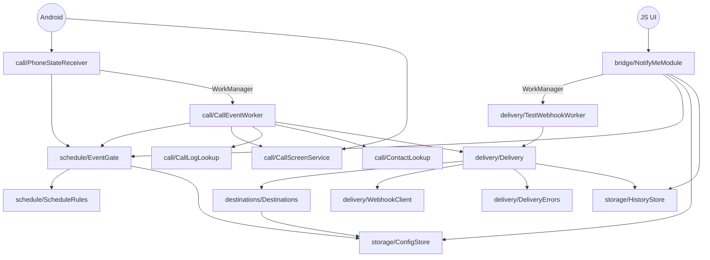

# 8. The Android engine

**What you'll learn:** the Android building blocks Notify-Me relies on, in plain terms for a web developer: broadcast receivers, WorkManager, call screening, content providers, SharedPreferences, runtime permissions, battery optimization and the "stopped state". For each one you'll see *where* it's used and *why*. Then there's a package-by-package tour of `com.notifyme` and notes on Android version differences.

Why is there native code at all? React Native's JavaScript only runs while the app is open. Notify-Me has to react to a phone call when the app is closed, maybe hours after you last opened it. Only native Android components can be woken up by the system for that. So the engine is native, and JS is just the settings screen.

---

## Android concepts, mapped to this app

### Manifest: the app's declaration to the system

[`AndroidManifest.xml`](../android/app/src/main/AndroidManifest.xml) is like a `package.json` plus routing table for the OS. It lists the permissions the app may ask for and the **entry points the system itself may start**. Our code never creates these classes; Android does.

| Entry point | Kind | Started when |
|---|---|---|
| `.MainApplication` | Application | The app process starts (for any reason, including a phone call). |
| `.MainActivity` | Activity (a screen) | You open the app. It hosts the React Native UI. |
| `.call.PhoneStateReceiver` | BroadcastReceiver | The phone's call state changes. |
| `.call.CallScreenService` | Service | Each incoming call, **only while the app holds the call-screening role**. |

`android:name` values are class names relative to the package (`com.notifyme`). If you move one of these classes to another package, update the manifest, or the app crashes or silently stops receiving events.

### BroadcastReceiver: "call me when X happens"

A **broadcast** is a system-wide event, like a DOM event fired by the OS. A **BroadcastReceiver** is a listener that the manifest registers ahead of time, so it works even when the app isn't running.

- Used by: [`call/PhoneStateReceiver.java`](../android/app/src/main/java/com/notifyme/call/PhoneStateReceiver.java), listening to `android.intent.action.PHONE_STATE`.
- Why: it's the only reliable "a call is ringing" signal that works with the app closed and without being the phone's dialer app.
- Rules: `onReceive()` must finish in about 10 seconds, and the receiver object is thrown away afterwards. That's why state is kept in `static` fields and the real work is handed off to WorkManager.

### WorkManager and Workers: a persistent background job queue

**WorkManager** is Android's job queue for work that *must eventually run*, even if the app is killed or the phone reboots. You describe a job (`OneTimeWorkRequest`) with input data and constraints. WorkManager stores it in its own small database and calls your **Worker**'s `doWork()` on a background thread when the constraints are met.

- Used by: [`call/CallEventWorker.java`](../android/app/src/main/java/com/notifyme/call/CallEventWorker.java) (call alerts, queued by the receiver) and [`delivery/TestWebhookWorker.java`](../android/app/src/main/java/com/notifyme/delivery/TestWebhookWorker.java) (the "Send test" button, queued by the bridge).
- Constraint used: **network `CONNECTED`**, so the job waits for the internet instead of failing offline.
- Return values: `Result.success()`, `Result.failure()` or `Result.retry()`. The last one makes WorkManager run the job again after an **exponential backoff** (30 s, 60 s, 120 s, …).
- Why not a plain thread? A thread dies with the process. WorkManager survives process death and reboots, respects Doze/battery rules, and gives us retries for free.

> ⚠ **Worker class-name gotcha.** WorkManager saves each queued job with the worker's **full class name** (e.g. `com.notifyme.call.CallEventWorker`). If you rename or move a worker class, jobs that were already queued under the old name can't be started after the update. During the restructure the workers moved (`com.notifyme.WebhookWorker` → `com.notifyme.delivery.TestWebhookWorker`, `com.notifyme.CallEventWorker` → `com.notifyme.call.CallEventWorker`). Only an alert queued at the exact moment of upgrading is affected. Workers don't appear in the manifest, so nothing reminds you of this. Don't rename workers casually.

### CallScreeningService + RoleManager: caller ID at ring time

A **CallScreeningService** is a service that Android consults for every incoming call, originally meant for spam-blocking apps. It only works for the app that holds the **call-screening role**, which the user grants in a system dialog. **RoleManager** is the API that shows that dialog.

- Used by: [`call/CallScreenService.java`](../android/app/src/main/java/com/notifyme/call/CallScreenService.java). The request comes from `requestScreeningRole()` in [`bridge/NotifyMeModule.kt`](../android/app/src/main/java/com/notifyme/bridge/NotifyMeModule.kt).
- Why: on Android 10+ the phone-state broadcast no longer includes the caller's number. The screening callback has it right at ring time.
- What we do with it: only **cache** the number (`lastNumber`, `lastNumberTs`). We always let the call through unchanged. `respondToCall(...)` with an empty response is **mandatory**; without it the call would hang. The receiver stays the single trigger, so there are no duplicate alerts.
- Contacts are excluded from screening unless the app also has `READ_CONTACTS`.

### ContentResolver: reading the call log and contacts

Android exposes shared data (call log, contacts, media…) through **content providers**. You query them with SQL-like calls via a **ContentResolver** and get a `Cursor` (a row iterator) back.

- [`call/CallLogLookup.java`](../android/app/src/main/java/com/notifyme/call/CallLogLookup.java) queries `CallLog.Calls` for the newest row since the ring: number, cached name, type (missed / rejected / …). It's the fallback number source when we don't hold the screening role. Some phones write the row at ring time, others only after the call ends, so `CallEventWorker` polls it for up to ~18 s.
- [`call/ContactLookup.java`](../android/app/src/main/java/com/notifyme/call/ContactLookup.java) turns a number into a contact name using `PhoneLookup`.
- Both return "nothing" (not a crash) if the permission is missing or the provider throws, which some OEM builds do.

### SharedPreferences: the native localStorage

**SharedPreferences** is a small key/value file private to the app. It's the closest thing to `localStorage`.

- Used by: [`storage/ConfigStore.java`](../android/app/src/main/java/com/notifyme/storage/ConfigStore.java) (settings) and [`storage/HistoryStore.java`](../android/app/src/main/java/com/notifyme/storage/HistoryStore.java) (activity log), both in the file `notify_me_prefs`.
- Why: both the UI (through the bridge) and the background engine read the same values, and they persist across restarts. `apply()` saves in the background without blocking.
- All keys are listed in [9. Storage and data](09-storage-and-data.md).

### Runtime permissions

Since Android 6, "dangerous" permissions must be declared in the manifest **and** granted by the user at run time.

| Permission | Why we need it | Asked in |
|---|---|---|
| `READ_PHONE_STATE` | Receive the ringing / off-hook / idle broadcast | JS: [`src/domain/permissions.ts`](../src/domain/permissions.ts), when you switch alerts on |
| `READ_CALL_LOG` | Read the caller's number (Android 10+) | same |
| `READ_CONTACTS` | Show a contact name; also needed for screening contacts | same |
| `POST_NOTIFICATIONS` (Android 13+) | Requested, but optional | same |
| `INTERNET` | Send webhooks (normal permission, granted automatically) | manifest only |
| `REQUEST_IGNORE_BATTERY_OPTIMIZATIONS` | Allowed to show the "don't optimize" dialog | manifest + `requestBatteryExemption()` |

The JS side asks with React Native's `PermissionsAndroid.requestMultiple`. The native side checks again (`ContextCompat.checkSelfPermission`) before every query, because the user can revoke a permission at any time in Settings.

### Battery optimization, Doze and OEM "autostart"

To save battery, Android may freeze apps in the background ("Doze", "App Standby"). Many manufacturers (Xiaomi, Samsung, Oppo, OnePlus…) go further and block background starts entirely unless the user enables "Autostart".

- `getBatteryStatus()` / `requestBatteryExemption()` in [`bridge/NotifyMeModule.kt`](../android/app/src/main/java/com/notifyme/bridge/NotifyMeModule.kt) check and request the exemption. Some OEMs block the direct dialog, so the code falls back to the full settings list.
- There's no API for OEM autostart. The Reliability card just links to the app's settings page and tells the user what to switch on.

### The "stopped state": open the app once

A freshly installed app is in the **stopped state**: Android won't deliver broadcasts to it until the user opens it at least once. After that the receiver keeps working, including after reboots, until the user **Force stops** the app. Force stop puts it back into the stopped state. So after installing, always open Notify-Me once.

---

## Package tour: `com.notifyme`

```
android/app/src/main/java/com/notifyme/
├── MainActivity.kt, MainApplication.kt   React Native boilerplate (+ registers our package)
├── bridge/       JS ↔ native
├── call/         noticing calls and finding the caller
├── schedule/     "should we alert right now?"
├── storage/      saved settings and history
└── delivery/     building and sending the message
    └── destinations/   one class per chat service
```

| Package | Classes | Job |
|---|---|---|
| (root) | `MainApplication.kt`, `MainActivity.kt` | Standard React Native template. `MainApplication` adds `NotifyMePackage()`. |
| `bridge` | `NotifyMeModule.kt`, `NotifyMePackage.kt` | The only code JS can call. Reads/writes stores, reports status, queues the test, asks for the role and the battery exemption. See [7. The native bridge](07-native-bridge.md). |
| `call` | `PhoneStateReceiver`, `CallEventWorker`, `CallScreenService`, `CallLogLookup`, `ContactLookup` | Detect ring / answer / hang-up, then work out who called and whether it was missed. |
| `schedule` | `EventGate`, `ScheduleRules` | `EventGate` loads settings; `ScheduleRules` is the pure decision (override > master > office hours), unit-tested in `src/test/.../ScheduleRulesTest.java`. |
| `storage` | `ConfigStore`, `HistoryStore` | SharedPreferences wrappers. Key names are a contract with existing installs. |
| `delivery` | `Alert`, `Delivery`, `DeliveryErrors`, `WebhookClient`, `TestWebhookWorker` | `Alert` = what to say. `Delivery` = send + record. `DeliveryErrors` = retry or give up, and the plain-language reason. `WebhookClient` = the HTTP POST. |
| `delivery.destinations` | `Destination` (interface), `Destinations` (registry), `DestinationSettings`, `TextOnlyDestination`, `Slack…`, `Discord…`, `Teams…`, `Cliq…`, `GenericDestination` | ★ Extension point. Each class knows one service's URL and JSON format. See [10. Destinations](10-destinations.md) and [guides/add-a-destination.md](guides/add-a-destination.md). |

**Who depends on whom** (arrows = "calls"):



Java vs Kotlin: the engine was originally written in Java and was kept as-is. The React Native template and the bridge are Kotlin. Both compile to the same bytecode and can call each other freely.

---

## Android version notes

| Android (API level) | What changes for us | Where it's handled |
|---|---|---|
| 9 and older (≤ 28) | `PHONE_STATE` broadcast includes the number (`EXTRA_INCOMING_NUMBER`). | `PhoneStateReceiver` passes it as the "legacy number". |
| **10 (29)** | The number is **removed** from the broadcast. The call-screening role becomes available. | `CallEventWorker` falls back to `CallScreenService` and the call log. `getScreening().supported` is false below 29. |
| 11 (30) | Better haptic constants (`CONFIRM` / `REJECT`). | `haptic()` picks them when available. |
| **13 (33)** | Notification permission becomes a runtime permission. | Requested in `src/domain/permissions.ts` (optional). |
| **15 (35)** | Apps are drawn edge-to-edge, and the manifest's `adjustResize` no longer shrinks the window for the keyboard. | `HomeScreen.tsx` uses `KeyboardAvoidingView behavior="height"` on 35+. |

`minSdkVersion` is 24 (Android 7) and `targetSdkVersion` is 36 (see `android/build.gradle`).

---

Next: [9. Storage and data](09-storage-and-data.md)
