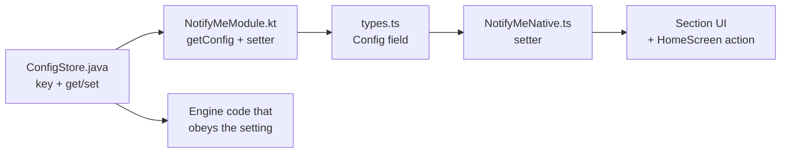

# Guide: add a setting

**What you'll learn:** the full path a setting travels (Android storage → bridge → TypeScript → screen) by adding a made-up example: **"Skip calls from saved contacts"**, a switch that, when on, posts only calls from unknown numbers.

Use the same steps for any value the user can change and the engine must respect while the app is closed.

## The path



## 1. Store it (Android)

[`storage/ConfigStore.java`](../../android/app/src/main/java/com/notifyme/storage/ConfigStore.java): add a key and a getter/setter next to the others.

```java
// Skip calls whose number is in the user's contacts.
private static final String KEY_SKIP_CONTACTS = "skip_contacts";

public static boolean isSkipContacts(Context ctx) {
    return prefs(ctx).getBoolean(KEY_SKIP_CONTACTS, false); // default for existing users
}

public static void setSkipContacts(Context ctx, boolean value) {
    prefs(ctx).edit().putBoolean(KEY_SKIP_CONTACTS, value).apply();
}
```

Choose the key name carefully: it's saved on phones and must never be renamed. The default value is what users who upgrade will get.

## 2. Expose it over the bridge (Kotlin)

[`bridge/NotifyMeModule.kt`](../../android/app/src/main/java/com/notifyme/bridge/NotifyMeModule.kt):

```kotlin
// inside getConfig's Arguments.createMap().apply { ... }
putBoolean("skipContacts", ConfigStore.isSkipContacts(ctx))

// new setter
@ReactMethod
fun setSkipContacts(value: Boolean) = ConfigStore.setSkipContacts(reactContext, value)
```

## 3. Type it (TypeScript)

[`src/native/types.ts`](../../src/native/types.ts), in `Config`:

```ts
/** Don't post calls from numbers saved in Contacts. */
skipContacts: boolean;
```

[`src/native/NotifyMeNative.ts`](../../src/native/NotifyMeNative.ts): add `setSkipContacts(value: boolean): void;` to `NativeApi`, and to the `NotifyMe` object:

```ts
setSkipContacts: (v: boolean) => Native.setSkipContacts(v),
```

[`jest.setup.js`](../../jest.setup.js): add `skipContacts: false` to the fake `getConfig` result and `setSkipContacts: jest.fn()` to the fake module.

## 4. Show it (UI)

In [`HomeScreen.tsx`](../../src/screens/home/HomeScreen.tsx), add an action that follows the usual three steps:

```ts
const onSkipContacts = (value: boolean) => {
  NotifyMe.setSkipContacts(value);          // 1. write
  app.setCfg({...cfg, skipContacts: value}); // 2. show immediately
  app.reread();                              // 3. read back
};
```

Pass `cfg.skipContacts` and `onSkipContacts` to a section, for example a new `SettingRow` in `ReliabilitySection` with a `<Switch>` as its `right` element.

## 5. Obey it (engine)

Decide where the rule belongs:

- **Whether to alert at all, from settings alone** → [`ScheduleRules`](../../android/app/src/main/java/com/notifyme/schedule/ScheduleRules.java) and [`EventGate`](../../android/app/src/main/java/com/notifyme/schedule/EventGate.java). Add a test to `ScheduleRulesTest`.
- **Depends on the caller** (like this example) → [`call/CallEventWorker.java`](../../android/app/src/main/java/com/notifyme/call/CallEventWorker.java), after the caller is resolved. A sketch, where `number` is the resolved caller number:
  ```java
  if (ConfigStore.isSkipContacts(ctx) && ContactLookup.nameFor(ctx, number) != null) {
      return Result.success(); // filtered on purpose, not an error
  }
  ```
- **Changes the message** → the `Destination` classes. Add a golden test.

## 6. Verify

```bash
npx tsc --noEmit && npm test
cd android && ./gradlew :app:testDebugUnitTest
npm run android        # native code changed → rebuild, Metro reload isn't enough
```

Then test on the phone. See [Testing and debugging](../11-testing-and-debugging.md).

## Checklist

- [ ] `ConfigStore` key (never renamed later) + getter with a sensible default + setter
- [ ] `getConfig` includes it; `@ReactMethod` setter added
- [ ] `Config` type + `NativeApi` + `NotifyMe` wrapper updated
- [ ] `jest.setup.js` fake updated
- [ ] UI control + HomeScreen action
- [ ] Engine obeys it, with a unit test where the logic is pure
- [ ] [Storage and data](../09-storage-and-data.md) table updated
